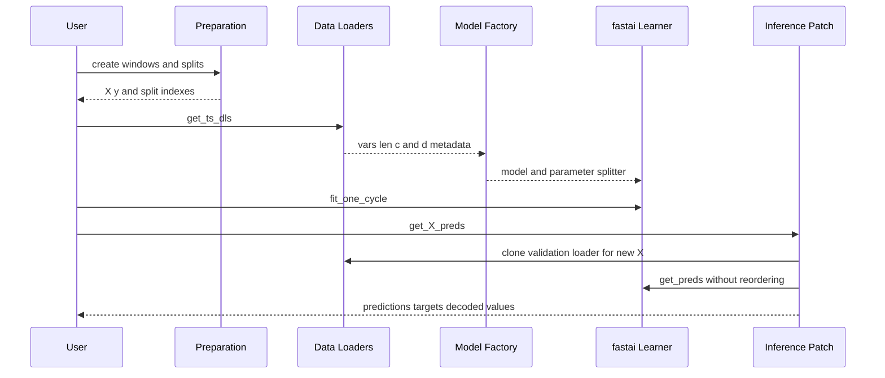

# Data and learning architecture

## End-to-end flow

This sequence shows the metadata bridge from prepared arrays to model construction and decoded inference.

## 1. Prepare sequences and protect validation boundaries

`SlidingWindow` in `tsai/data/preparation.py` turns a 1D/2D array, tensor, or DataFrame into model-ready windows. It can select X/y columns, sort DataFrames, control stride and horizon, pad incomplete windows, and run an output processor. Its output X is transposed to `[samples, variables, sequence length]`.

When a non-positive horizon could place the same columns in both X and y, the default `check_leakage=True` requires disjoint `get_x` and `get_y` selections unless a `y_func` explicitly changes target construction. `SlidingWindowPanel` applies the same logic by entity group.

Split utilities in `tsai/data/validation.py` cover random train/validation/test splits, stratification and balancing, walk-forward and forecasting splits, overlap checks, and `leakage_finder`. These controls implement the leakage and temporal-validation rules described in [domain concepts](/openwiki/domain-concepts.md).

## 2. Convert arrays into datasets and loaders

`get_ts_dls` in `tsai/data/core.py` is the main bridge:

1. `_check_splits` normalizes missing or partial split definitions and requires a non-empty training split.
2. `TSDatasets` converts X to 3D, selects variables/steps, and chooses transform-list behavior based on whether transforms are absent, vectorized, or item-wise.
3. Each split becomes a dataset subset.
4. `TSDataLoaders.from_dsets` creates one loader per split. Training defaults to shuffle and drop-last; later loaders do neither.

`inplace=True` can eagerly preprocess and stack values, trading memory for faster access. Lower-level data structures also accommodate lazy/indexed sources, so changes to array conversion and copying deserve memory tests. Recent history reduced `create_array` memory use, reinforcing that large-array behavior is an intentional concern.

### Metadata contract

The loaders expose the contract consumed by model construction:

| Property | Meaning | How it is derived |
|---|---|---|
| `vars` | Number of input variables/channels | Input batch shape or `TSTensor.vars`. |
| `len` | Sequence length, or spatial-like trailing dimensions | Input batch shape or `TSTensor.len`. |
| `c` | Number of target classes/outputs | Vocabulary length for categorical targets, otherwise 1. |
| `d` | Non-scalar target shape | Dimensions after the target batch axis. |
| `cat` | Whether a vocabulary is present | Used in loss inference and class statistics. |

This contract connects data handling to [model and task semantics](/openwiki/domain-concepts.md); it should be reviewed whenever transforms alter target rank or vocabulary.

## 3. Resolve and construct a model

Users can pass a model instance, an architecture callable, or a string. String names go through `get_arch` in `tsai/learner.py`, a lazy but manually maintained resolver. `build_ts_model` in `tsai/models/utils.py` then reads `vars`, `c`, `len`, and `d` from the loaders.

The factory dispatches by architecture name:

- PatchTST and long-term forecasting models receive `pred_dim=d`.
- Recurrent-attention, RNN-FCN, ConvTran, and related families receive `d=d`.
- many sequence-aware families receive `seq_len`.
- vision xresnets use `n_out`.
- ROCKET families use specialized signatures.
- the fallback receives `c_in` and `c_out`.

For shaped targets, the factory injects an n-dimensional head where the architecture supports it. When multimodal feature indexes or embeddings are supplied, construction delegates to `MultInputWrapper`. Models with `backbone` and `head` use `ts_splitter`, creating separate parameter groups for transfer learning and freezing.

**Extension rule:** when adding or renaming an architecture, update its notebook, exported model, model aggregation, `all_arch_names`, `get_arch`, and the appropriate `build_ts_model` dispatch branch. Then test representative input and target shapes; string resolution alone is insufficient.

## 4. Build and train a learner

There are two entry styles:

- `TSClassifier`, `TSRegressor`, and `TSForecaster` in `tsai/tslearner.py` accept arrays and internally call `get_ts_dls` and `build_ts_model`. Their default architecture is `InceptionTimePlus`. Classification falls back to cross entropy; regression and forecasting fall back to mean squared error when the data does not provide a loss.
- `ts_learner` in `tsai/learner.py` accepts existing loaders and constructs a standard fastai `Learner`.

After construction, the main training loop belongs to fastai. `tsai/learner.py` patches selected learner conveniences, but callbacks, event ordering, optimization, validation, and schedulers remain fastai responsibilities. The [integration map](/openwiki/integrations.md) records this dependency boundary.

## 5. Persist and infer

The README demonstrates standard fastai persistence with `Learner.export` and `load_learner`. `get_X_preds`, patched by importing `tsai.inference`, performs inference by:

1. calling `self.dls.valid.new_dl(X, y, bs)`;
2. invoking `Learner.get_preds` with `reorder=False`;
3. decoding predictions through the target transform when a decoder is present.

`NumpyDataLoaders.new_dl` asserts that X has exactly three dimensions. Inference therefore depends on the exported learner retaining a compatible validation loader and transform pipeline. Test export/load and new-data prediction whenever dataset subclasses, target transforms, or validation-loader construction change.

`Learner.save_all` and `load_all` in `tsai/learner.py` provide a more granular persistence path for loaders, model/optimizer state, and an exported learner.

## Failure-oriented checklist

- **Wrong model signature:** inspect `get_arch`, architecture `__name__`, and `build_ts_model` name-based branches.
- **Unexpected output shape or loss:** inspect loader `c`, `d`, `cat`, target transform, and any injected custom head.
- **Prediction decoding mismatch:** verify the learner was imported with the inference patch and that target transforms implement decoding.
- **Temporal leakage:** inspect horizon, X/y column overlap, window stride, and split overlap with `leakage_finder`.
- **Memory spike:** compare `inplace` behavior, eager stacking, copying, and array conversion on realistic dataset sizes.
- **Transfer-learning grouping issue:** verify the built model exposes meaningful `backbone` and `head` attributes before `ts_splitter` is selected.
