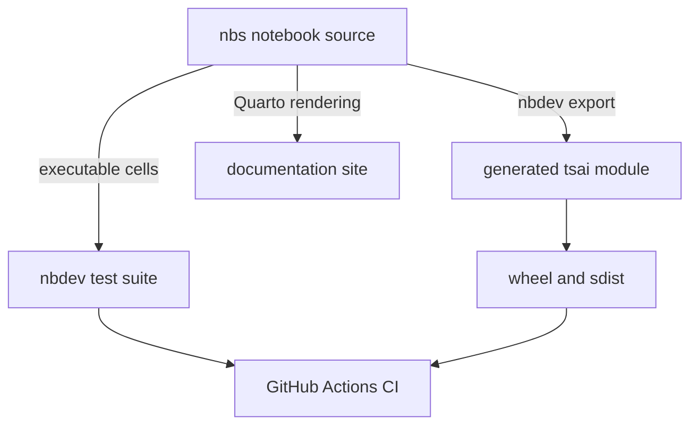
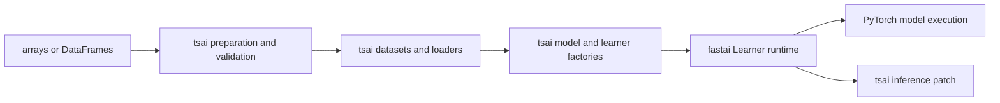

# Architecture overview

## Architectural intent

`tsai` is an extension library, not a standalone training framework. It supplies time-series-specific data preparation, tensor and loader types, model architectures, model/learner factories, callbacks, metrics, and integrations. PyTorch supplies tensors and neural-network execution; fastai supplies the `Learner`, optimizer/callback event loop, transforms, and data-block foundations.

The [domain concepts](/openwiki/domain-concepts.md) define the time-series semantics that this architecture implements. The detailed runtime sequence is in [data and learning architecture](/openwiki/architecture/data-and-learning.md).

## Notebook-first source ownership

This diagram shows how one notebook feeds library code, tests, and API documentation.

Every representative generated module inspected (`tsai/data/core.py`, `tsai/learner.py`, `tsai/models/utils.py`) names its owning notebook in an `AUTOGENERATED! DO NOT EDIT!` header. `CONTRIBUTING.md` therefore directs contributors to edit `nbs/*.ipynb`, mark exported code with `#|export`, rerun the notebook, and use nbdev to export and test. The [development workflow](/openwiki/workflows/development.md) is the operational expression of this ownership rule.

## Package layers

| Layer | Primary paths | Responsibility |
|---|---|---|
| Public facades | `tsai/all.py`, `tsai/basics.py`, `tsai/data/all.py`, `tsai/models/all.py` | Compose wildcard-import surfaces for users. |
| Data | `tsai/data/` | Validation and split logic, windowing, datasets/loaders, transforms, preprocessing, external datasets, feature extraction, tabular/image/mixed inputs. |
| Learning | `tsai/learner.py`, `tsai/tslearner.py`, `tsai/inference.py` | Resolve architectures, build fastai learners, add time-series conveniences and prediction patches. |
| Models | `tsai/models/` | Neural, convolutional, recurrent, transformer, ROCKET/Hydra, tabular, and multimodal architectures plus shared layers/factories. |
| Evaluation and behavior | `tsai/losses.py`, `tsai/metrics.py`, `tsai/callback/`, `tsai/analysis.py`, `tsai/calibration.py` | Task losses, metrics, callbacks, interpretation, and calibration. |
| Integrations and utilities | `tsai/optuna.py`, `tsai/wandb.py`, `tsai/export.py`, `tsai/utils.py` | Experiment tuning/tracking, notebook export, and shared helpers. |

The [source map](/openwiki/source-map.md) maps these generated paths back to authoritative notebooks.

## Public import surfaces and side effects

- `tsai.basics` is the smaller common surface: data basics, losses/metrics, learner APIs, inference, analysis, core callbacks, and optimizer helpers.
- `tsai.all` adds all data modules, all model modules, all callbacks, calibration, Optuna, W&B, and export helpers.
- `tsai.models.all` eagerly imports nearly every model module. Prefer targeted imports when import cost or optional dependency isolation matters.
- Some behavior is installed through import side effects. `tsai/inference.py` exports no names through `__all__`, but importing it applies `get_X_preds` to fastai's `Learner` with `@patch`.

Because wildcard facade imports compose many modules and patches, changing an import can alter global fastai class behavior even when no public name is added.

## Runtime boundaries

This diagram separates tsai's time-series adaptation from the fastai training loop and PyTorch execution engine.

`tsai` owns the metadata bridge between data and model construction: loader properties expose input channels, sequence length, output cardinality, and target shape; `build_ts_model` converts those values into architecture-specific constructor calls. Once the learner is created, training methods such as `fit_one_cycle` are fastai behavior. This boundary is why fastai compatibility and model signature dispatch are central maintenance risks.

## Architectural pressure points

1. **Generated-source drift:** a direct edit under `tsai/` is overwritten by export and leaves the notebook source stale.
2. **Manual architecture resolution:** `all_arch_names` and the `get_arch` `if/elif` resolver in `tsai/learner.py` are separately maintained.
3. **Name-based constructor dispatch:** `build_ts_model` branches on architecture names and substrings to choose signatures. Renaming or wrapping a callable can route it incorrectly.
4. **Shape-derived behavior:** loader metadata controls output heads, loss defaults, and prediction decoding. A shape change can cross data, model, and inference boundaries.
5. **Facade import breadth:** `tsai.all` is convenient but eager. New optional integrations should remain lazily imported inside feature calls when possible, as Optuna and W&B currently are.

Changes at these pressure points should follow the [testing and release runbook](/openwiki/operations/testing-and-release.md), not only a local unit check.
