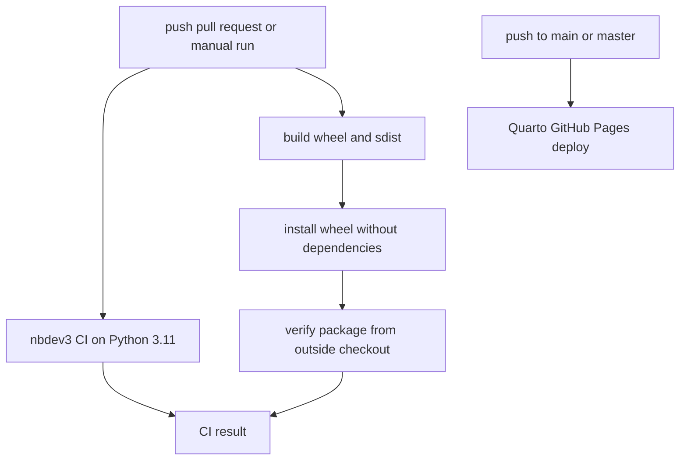

# Testing, CI, documentation, and release operations

## Test model

There is no conventional `tests/` tree. Tests live primarily in executable cells in `nbs/*.ipynb`, next to exported code and documentation. This design is enforced through the [notebook-first development workflow](/openwiki/workflows/development.md).

`pyproject.toml` configures `local slow extras onnx` as excluded flags for the normal nbdev suite. Representative coverage includes:

- split and leakage behavior in `nbs/003_data.validation.ipynb`;
- preprocessing and encoders in `nbs/009_data.preprocessing.ipynb`;
- layers, shapes, and parameter counts in model notebooks;
- serialization/TorchScript in RNN and PatchTST notebooks;
- sklearn pipelines in ROCKET and MiniRocket notebooks.

Recent commits deliberately removed NATOPS and Adult Sample downloads from default tests. Keep the normal suite deterministic and offline-capable; isolate genuine network integration tests behind an explicit flag.

## Local verification levels

### Standard feature change

```bash
nbdev-prepare
git diff --check
git status --short
```

On Apple Silicon/MPS instability, replace `nbdev-prepare` with the serial sequence documented in the [development playbook](/openwiki/workflows/development.md).

### Optional or serialization feature

Run the relevant notebook with its excluded dependency installed, and include the associated `extras`, `onnx`, or `slow` cells. The default CI exclusions mean a green standard suite does not validate every optional path.

### Packaging change

Mirror `.github/workflows/test.yaml`:

```bash
python -m build
python -m venv /tmp/verify
/tmp/verify/bin/pip install --no-deps dist/*.whl
```

Run artifact checks from outside the checkout, such as `/tmp`, then import `tsai`, `tsai.data`, `tsai.models`, and `tsai.callback`, and verify that core module specs exist. Running inside the repository can falsely pass by importing the source tree.

## CI topology



This diagram shows the independent notebook-test and artifact-verification paths, plus documentation deployment.

The artifact job was added after the 1.0.0 release omitted all subpackages. Package discovery now includes both `tsai` and `tsai.*`; preserve the artifact-level check when editing packaging.

CI currently tests Python 3.11 explicitly, while metadata declares Python 3.10 and newer. There is no visible coverage, lint, static-type, security-scan, or platform matrix job. Shared fastai CI and deploy actions are referenced at `@master`, so their behavior can change without a repository commit.

## Documentation operations

API documentation is generated from notebooks with nbdev/Quarto. Build and preview locally with:

```bash
nbdev-docs
nbdev-preview
```

`.github/workflows/deploy.yaml` publishes on every push to `main` or `master`. `_docs` is generated output and ignored by Git. This OpenWiki is a practical engineering map over the source and generated API docs; the current uncommitted `.github/workflows/openwiki-update.yml` schedules a daily OpenWiki update and opens a pull request.

## Packaging and release state

`pyproject.toml` is the packaging source of truth:

- setuptools build backend;
- Python `>=3.10`;
- dynamic version from `tsai.__version__`;
- recursive package discovery for `tsai.*`;
- PyPI distribution, with the old conda channel no longer updated;
- `nb2py` console script from `tsai.export:nb2py`.

The repository does not contain a committed PyPI publication workflow. Release history indicates manual version/changelog/tag and publish steps, but the exact owner and upload command are not recorded. At this snapshot, source version `1.0.2` is newer than the latest local tag and changelog section (`1.0.1`). Treat release publication as requiring maintainer confirmation.

`environment.yml` also appears older than current `pyproject.toml` dependency floors and PyPI-only guidance. Do not use it as authoritative without reconciliation.

## Recent history and why it matters

| Change | Operational lesson |
|---|---|
| 1.0 migration to `pyproject.toml`, nbdev 3, Python 3.10+, newer framework floors, and PyPI-only distribution | Packaging and contributor commands changed together; consult current config rather than legacy setup files. |
| 1.0.0 artifact omitted subpackages; 1.0.1 fixed discovery and added clean-wheel CI | Always verify built artifacts outside the checkout. |
| `ipykernel` moved to a lazy import in export code | Optional/dev dependencies must not break base imports. |
| External downloads removed from default notebook tests | Keep normal CI independent of flaky networks. |
| `create_array` memory use reduced | Test realistic large inputs, not only output correctness. |
| `Reshape` made TorchScript-compatible | Shared layers need serialization/compiler compatibility tests where supported. |
| ROCKET sklearn pipelines explicitly initialized | Validate full estimator/pipeline lifecycle, not only transform output. |
| Optuna multi-objective and empty-resume handling added | Test both single/multi-objective studies and interrupted or empty persisted states. |

## Incident triage

- **Import works locally but fails from wheel:** rebuild and verify outside the checkout; inspect `[tool.setuptools.packages.find]`.
- **Notebook and module disagree:** rerun `nbdev-export`, identify the owning notebook, and discard direct generated-module edits.
- **CI hangs or fails on network:** locate unflagged dataset downloads and replace with local fixtures or mark the integration explicitly.
- **MPS worker crashes:** run nbdev tests in-process with `--n_workers 0`.
- **Optional feature breaks base import:** move third-party imports inside the feature function and provide a targeted installation message.
- **Docs differ from code:** update and rerun the owning notebook, then rebuild Quarto output rather than editing generated docs.

The [integration map](/openwiki/integrations.md) lists which features require extra dependencies and which are currently undeclared.
