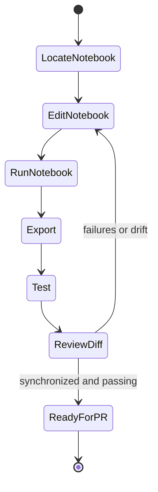

# Notebook-first development workflow

## Source-of-truth rule

Edit `nbs/*.ipynb`, not the generated implementation under `tsai/`. Generated modules identify their source notebook in the opening header, making them useful as a symbol index. The [source map](/openwiki/source-map.md) provides the common mappings.

This workflow exists because nbdev uses the same notebook to produce code, executable tests, and API documentation. Bypassing it can make runtime code disagree with tests and published docs, violating the architecture described in the [overview](/openwiki/architecture/overview.md).

## One-time setup

```bash
python -m pip install -e ".[dev]"
nbdev-install-hooks
```

Python 3.10 or newer is required. The hooks clean notebook outputs and metadata to reduce noisy diffs and merge conflicts. `CONTRIBUTING.md` recommends Python 3.11 for a contributor environment, matching current CI.

## Change lifecycle



This lifecycle keeps notebook source, generated modules, tests, and documentation synchronized.

### 1. Locate the owner

Find the symbol under `tsai/`, then follow its generated header to the corresponding notebook. Typical mappings are direct, such as `tsai/data/core.py` to `nbs/006_data.core.ipynb` and `tsai/models/utils.py` to `nbs/030_models.utils.ipynb`.

### 2. Edit code, tests, and explanation together

- Put exported library code in cells marked `#|export`.
- Add executable examples/assertions near the feature.
- Update notebook Markdown so the generated API documentation explains behavior and constraints.
- Restart and run the notebook end to end. `CONTRIBUTING.md` treats a clean full run as a prerequisite.

For behavior crossing domains, update every owning notebook involved. For example, adding a model can touch its architecture notebook, `nbs/018_learner.ipynb` for name resolution, and `nbs/030_models.utils.ipynb` for constructor dispatch.

### 3. Export and test

On Linux or CI:

```bash
nbdev-prepare
```

This runs export, tests, and cleaning in sequence. On Apple Silicon, parallel notebook execution can destabilize PyTorch's MPS/Metal service. Use:

```bash
nbdev-clean
nbdev-export
nbdev-test --n_workers 0 --do_print --timing
```

The configured default test flags in `pyproject.toml` exclude `local`, `slow`, `extras`, and `onnx` cells. Run relevant flagged cells explicitly when changing optional integrations or serialization paths; see [testing and release operations](/openwiki/operations/testing-and-release.md).

### 4. Build docs when intentionally changing documentation

```bash
nbdev-docs
nbdev-preview
```

These require Quarto (`nbdev-install-quarto` if absent). GitHub Pages is also rebuilt on pushes to `main` or `master` through `.github/workflows/deploy.yaml`.

### 5. Review synchronized diffs

A notebook implementation change should normally produce both an `.ipynb` change and its generated `.py` change. Review:

```bash
git status --short
git diff --check
git diff
```

Look for unexpected notebook metadata, output churn, generated files without source changes, or source changes without regenerated modules.

## Change-specific guidance

### Data preparation or validation

Start in `nbs/003_data.validation.ipynb`, `nbs/004_data.preparation.ipynb`, or `nbs/006_data.core.ipynb`. Test shape conventions, temporal/index leakage, empty validation sets, large-array memory, and both eager/lazy paths. Re-read the [data and learning flow](/openwiki/architecture/data-and-learning.md).

### New or changed model

Start in the architecture notebook, then inspect:

- `nbs/018_learner.ipynb` for `all_arch_names` and `get_arch`;
- `nbs/030_models.utils.ipynb` for name-based constructor dispatch, target shape, multimodal wrapping, and transfer learning;
- `tsai/models/all.py` aggregation if the model should be in the broad facade.

Test direct callable construction and string resolution, scalar and shaped outputs where supported, serialization/TorchScript where relevant, and `backbone`/`head` parameter grouping.

### Learner, transform, or inference behavior

Start in `nbs/018_learner.ipynb`, `nbs/019_inference.ipynb`, and `nbs/022_tslearner.ipynb`. Test classification and regression loss inference, validation-less learners, target decoding, exported learner reload, and prediction on new 3D X.

### Optional integration

Keep imports lazy so `tsai.all` remains importable without the optional package. Add a targeted installation error and mark dependency-requiring notebook cells with `#|extras` or the appropriate configured flag. Update [integrations](/openwiki/integrations.md) and packaging metadata if the dependency should be installable through a named extra.

### Packaging

Build both wheel and sdist, install the wheel into a clean environment, and perform checks outside the repository checkout. This prevents the local `tsai/` directory from masking missing package files—the exact failure that affected release 1.0.0.
